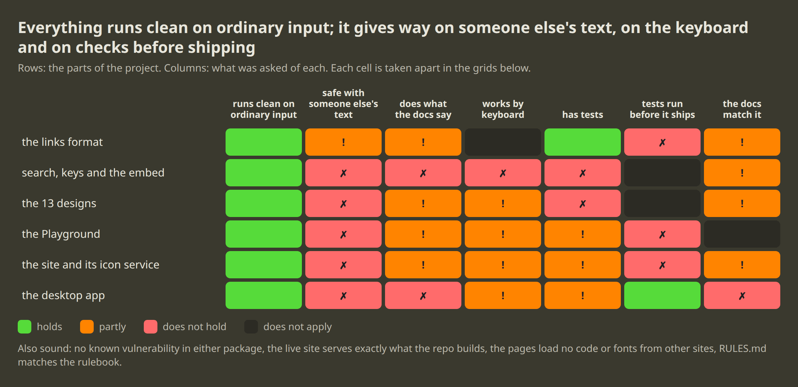
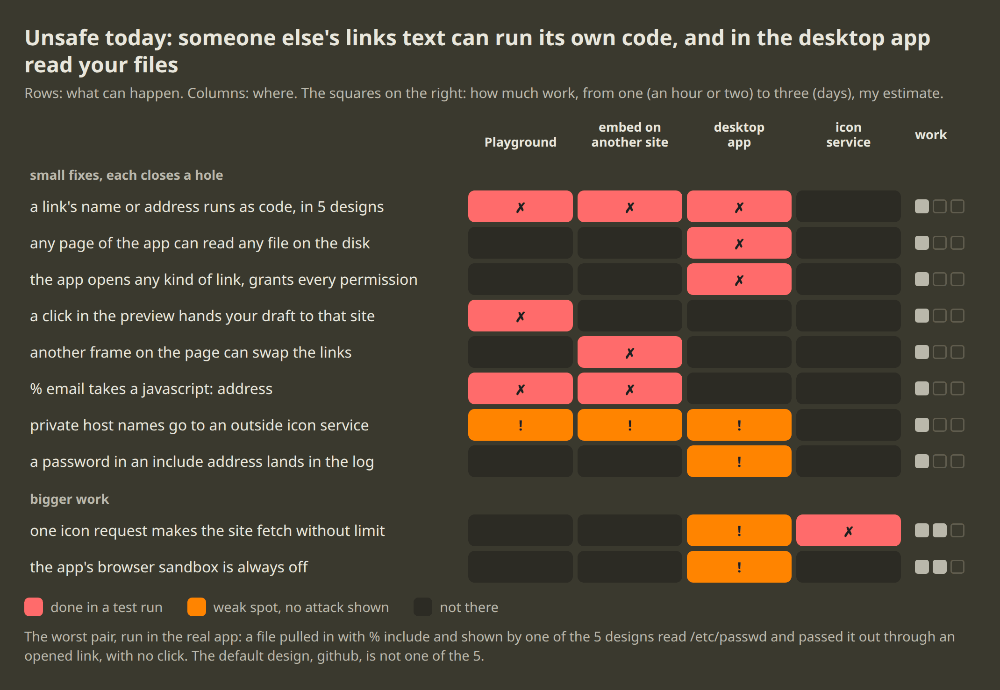
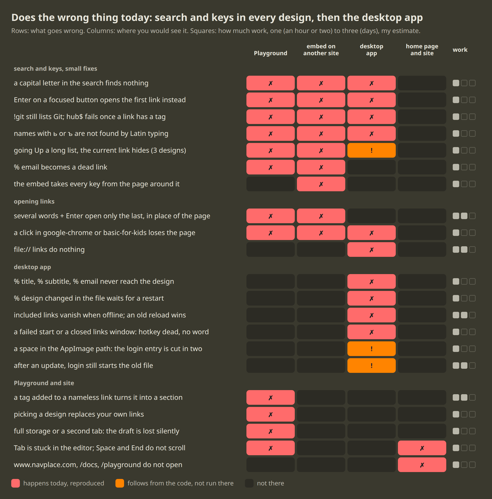
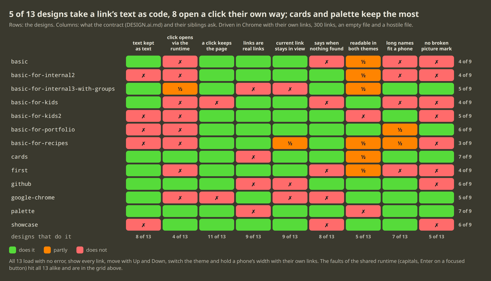

# Audit, 9 November 2026

A full audit of NavPlace at `082fe9f`: the links format, the shared runtime
and the embed, the 13 designs, the Playground, the site with its icon
service, and the desktop app. Each part was read from scratch and driven
for real: Chrome on the built site, the desktop app under Xvfb, node for
the parser, curl on the live site.

Nothing was changed by the audit itself. A row below is ticked when its
fix lands.

## Where each part stands

## Unsafe

- [x] A link's name or address runs as code in 5 designs (`showcase`,
  `basic-for-internal2`, `basic-for-kids2`, `basic-for-portfolio`,
  `basic-for-recipes`) and in the example of `docs/DESIGN.ai.md`
- [x] Any page of the desktop app can read any file on the disk, through
  the settings address of `navplace://app/`
- [x] The desktop app hands any kind of link to the system
- [x] The desktop app grants every permission a page asks for
- [x] A click in the Playground's preview hands the draft to the linked site
- [x] Another frame on the page can swap an embedded design's links
- [x] `% email` takes a `javascript:` address
- [x] Text typed into the Playground's JSON pane is drawn as code
- [x] Private host names go to an outside icon service
- [x] A password in an include address lands in the log
- [x] One icon request makes the site fetch without limit, and an odd icon
  address gives an error instead of a tile
- [ ] The desktop app's browser sandbox is always off (`afterPack.js`);
  taking the switch out needs a try on Ubuntu

## Does the wrong thing

Search and keys:

- [x] A capital letter in the search finds nothing
- [x] Enter or Space on a focused button or link opens the first link instead
- [x] `!git` still lists a link named Git, `git/api` misses a link with
  one word in its name and the other in its address
- [x] `hub$` fails once a link has a tag
- [x] Names with `ь` or `ъ` are not found by Latin typing
- [x] Going Up a long list, the current link hides under the top bar
  (`github`, `google-chrome`, `basic-for-internal3-with-groups`)
- [x] `% email` becomes a dead link
- [x] The embed takes every key from the page around it
- [x] The embed misses an indented `% design`, and shows three sample
  links for no links

Opening links:

- [x] Several words + Enter open only the last link on the web, in place
  of the page
- [x] A click in `google-chrome` or `basic-for-kids` loses the page
- [ ] `file://` links do nothing in the desktop app

The desktop app:

- [ ] `% title`, `% subtitle`, `% email` never reach the design
- [x] `% design` changed in the file waits for a restart
- [x] Included links vanish when offline
- [x] An older reload overwrites a newer one
- [x] Includes are pulled one after another, with no limit on time or size
- [x] A start that fails shows nothing
- [x] Settings open, the links window closed: the hotkey is dead
- [ ] A space in the AppImage path cuts the login entry in two
- [ ] After an update, login still starts the old file

The Playground and the site:

- [ ] A tag added to a link with no name turns it into a section; two
  parts changed at once garble the address
- [ ] Picking a design replaces the visitor's own links
- [ ] A full storage stops saving the draft, with no word
- [ ] Two tabs overwrite each other's draft
- [ ] Tab cannot leave the editor
- [ ] Space, Home and End do not scroll the home page
- [ ] `/docs` and `/playground` do not open
- [ ] The home page shows an old version of the app
- [ ] The site sends no security headers

## The designs

- [x] A click opens through the runtime: not in `basic`,
  `basic-for-internal2`, `basic-for-kids`, `basic-for-kids2`,
  `basic-for-portfolio`, `basic-for-recipes`, `first`, `google-chrome`;
  `basic-for-internal3-with-groups` opens its own way
- [ ] Links are real links: not in `basic-for-internal3-with-groups`,
  `cards`, `github`, `palette`
- [ ] Says when nothing is found: not in `basic`, `basic-for-kids`,
  `first`, `google-chrome`, `showcase`
- [ ] Readable in both themes: not in `basic-for-kids2`, `palette`; partly
  in `basic`, `first`, `basic-for-internal2`,
  `basic-for-internal3-with-groups`, `basic-for-recipes`, `cards`
- [ ] Long names fit a phone: not in `basic`, `basic-for-internal2`,
  `basic-for-kids`, `first`; partly in `basic-for-portfolio`,
  `basic-for-recipes`
- [ ] No broken picture mark: not in `basic`, `basic-for-internal2`,
  `basic-for-kids`, `basic-for-kids2`, `basic-for-recipes`, `first`,
  `github`, `showcase`

The first and third columns of the picture are rows above: text kept as
text, and a click that keeps the page.

## Docs and checks

- [ ] `docs/ABOUT.ai.md` still speaks of sync and sign-in; it, `ABOUT.md`
  and `DESIGN.ai.md` name commands and paths that are gone
- [ ] The desktop documents describe an older app: no settings window, no
  login entry, old function names
- [ ] `src/www/docs.html` says what the code does not do, and leaves out
  what it does
- [ ] The site's tests never run in CI, and nothing runs on a pull request
- [ ] `bin/self-check` passes a build with a broken parser
- [ ] The rules linter finds 15 faults outside the filter copy
- [ ] Leftovers: a helper nothing requires, two dependencies nothing
  uses, ignore lines for folders nothing writes
- [ ] No test for the runtime, the embed, the search filter

## Sound

- The parser never throws: empty text, CRLF, tabs, a BOM, bad addresses,
  200,000 random lines.
- No link or setting reaches a shell in the desktop app; its network gate
  holds; a page has no access to Node.
- The live site serves exactly what the repository builds; the pages load
  no code or fonts from other sites.
- All 13 designs load with no error, show every link, move with Up and
  Down, switch the theme and hold a phone's width with their own links.
- `npm audit` finds nothing in either package.

## Not covered

A real GNOME session, a phone, Firefox and Safari, the live icon service
against hostile hosts.
